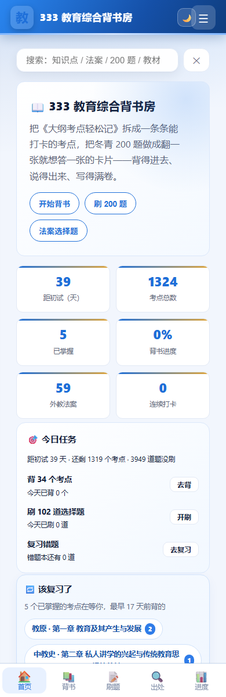
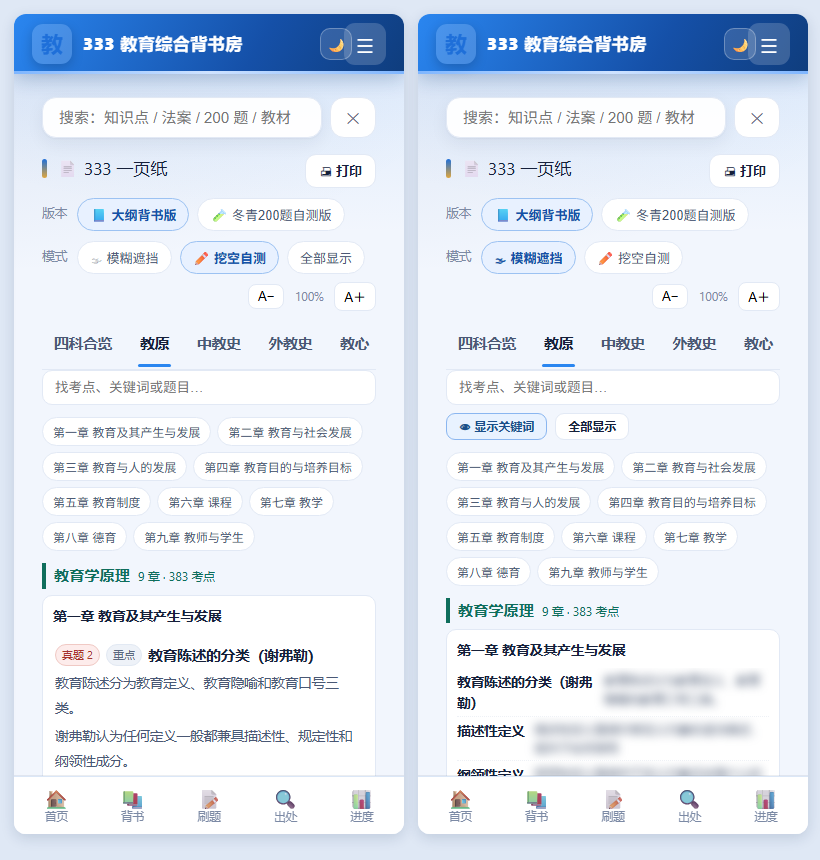
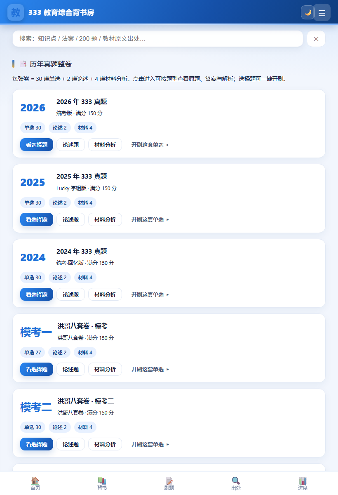
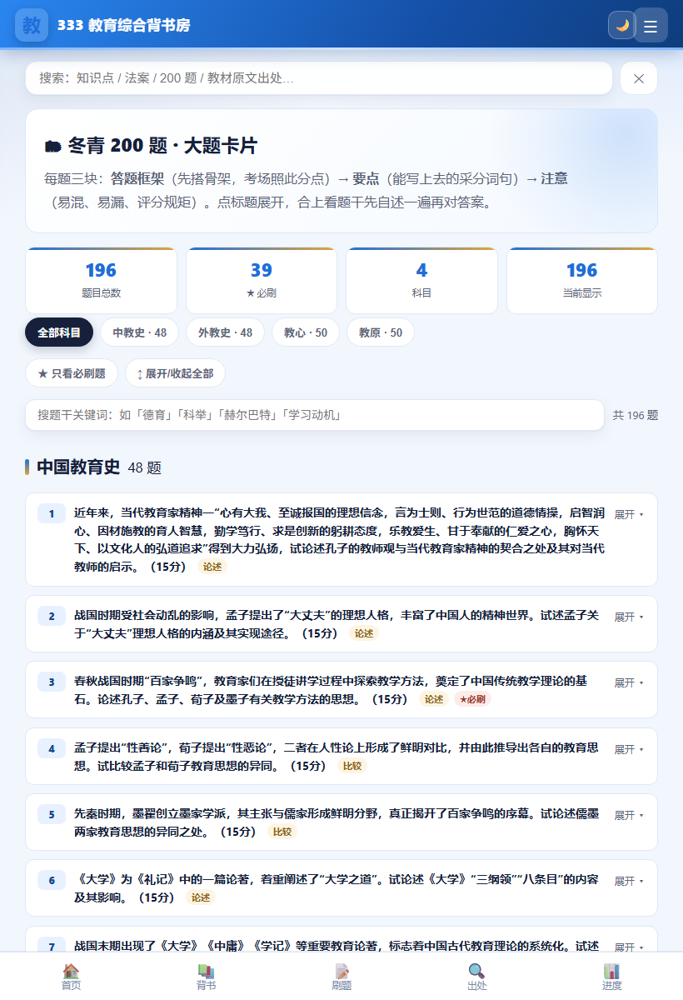
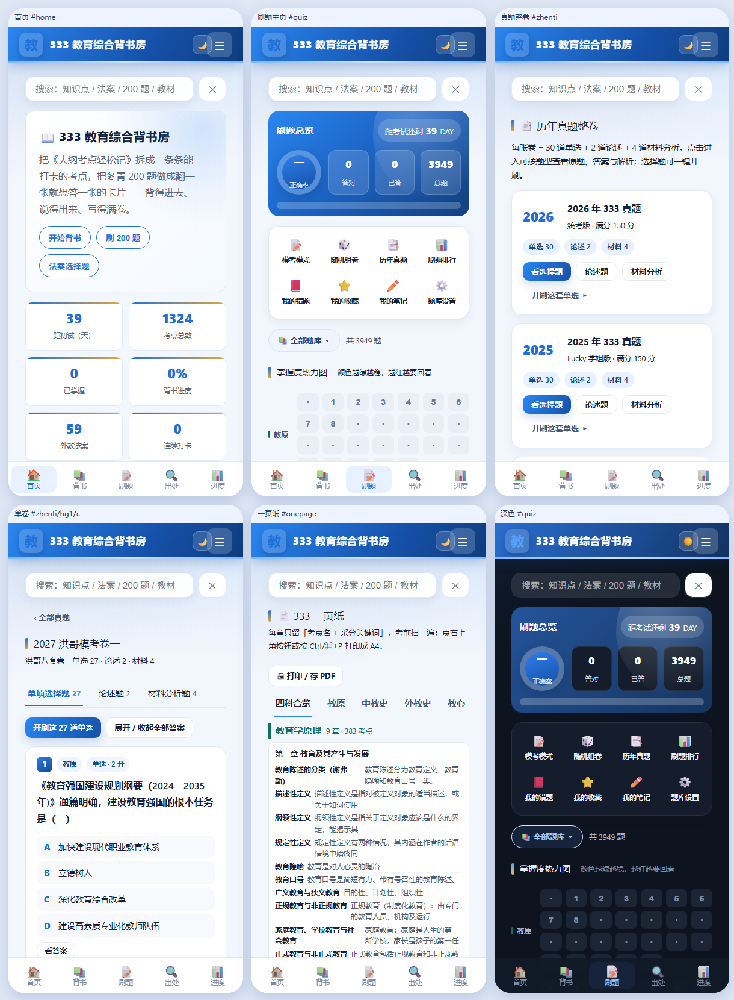
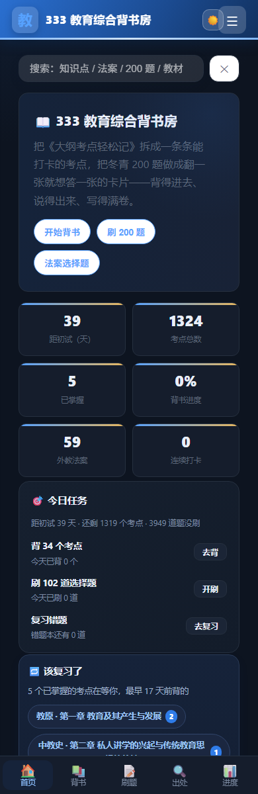

# 333 背书房 · 教育综合考研离线背书 / 刷题一体站

> 1324 个考点、4204 道题、17 套整卷，装进一个 APK 或一个 HTML 文件里。
> 不联网、不注册、不收集任何数据，打开就能背。

  
  
  
  
  
  

⭐ **如果这个项目对你有用，点个 Star 再走** —— 这是我继续更新的最大动力。

---

## 这是什么

给 333 教育综合（教原 / 中教史 / 外教史 / 教心）做的一个**单机离线**复习工具。

它把「背书」和「刷题」放在同一个应用里：左边按章节背考点，右边按老师/科目刷题，真题整卷单独成块，
错题、掌握度、复习计划都在本地自动记录。核心只有一句话——**拿起平板就能背，不用等加载，不用连网**。

- **两种形态，一份内容**：安卓 APK（推荐）或单文件 HTML（浏览器直接打开）
- **四本书全**：教育学原理 383 考点、中国教育史 373、外国教育史 274、教育心理学 294
- **题量大**：冬青 1151 + 丹丹 1187 + 凯程 1332 + 真题 89 + 模拟卷 398 + 外教法案 47 = **4204 题**
- **整卷齐全**：2024 / 2025 / 2026 三年真题各「30 单选 + 2 论述 + 4 材料」，另有洪哥八套、丹丹六套模拟卷
- **原文可查**：内置 22 本教材约 5200 页原文，考点能追到「哪本书、哪一版、第几页」

## 下载

| 文件 | 大小 | 适用 |
| --- | --- | --- |
| [`333beishufang-1.1.0.apk`](333beishufang-1.1.0.apk) | 4.5 MB | 安卓手机 / 平板，装完即用，图标在桌面 |
| [`333beishufang-tablet.html`](333beishufang-tablet.html) | 14.5 MB | 任意浏览器，双击打开；iPad / 电脑 / 不想装 APK 时用 |
| [`docs/manual.pdf`](docs/manual.pdf) | 0.9 MB | 图文说明书（安装、功能、语音、常见问题） |

> **一键下载**：[Releases 页面](https://github.com/Jason-Dyf/333beishufang/releases/latest)（APK 与说明书 PDF 已挂在 v1.1.0）。
> 单文件 HTML 在仓库根目录，点文件名 → 右上角 **Download raw file**。
> 国内访问 GitHub 慢的话，可以先把仓库整个 `Code → Download ZIP` 下下来再解压。

## 界面

| 首页（今日任务 + 复习队列） | 一页纸 · 挖空自测 |
| --- | --- |
|  |  |

| 真题整卷 | 冬青 200 题 |
| --- | --- |
|  |  |

| 手机六视图 | 深色模式 |
| --- | --- |
|  |  |

## 核心功能

### 1. 背书：按章节推进，背完就打勾
- 39 章、1324 个考点，每章显示「已掌握 / 总数」和进度条
- 考点正文按「框架 → 要点 → 关键词」分层，关键词高亮
- 一键「标记掌握」，系统按 **1 → 3 → 7 → 15 天** 的间隔把考点送回首页「🔁 该复习了」

### 2. 刷题：按老师拆库，按章节练
- 题库：冬青 1200、丹丹 1000、凯程、真题、模拟卷、外教法案，可整库刷也可只刷一章
- 答完立刻出解析；错了自动进错题本，按「科目 → 章节」聚类，可以「只刷本章错题」
- 掌握度热力图：每章一个格子，颜色越深正确率越高，点格子直接开刷

### 3. 真题：整卷还原，能跳转
- 2024 / 2025 / 2026 三年真题，严格按考场结构：30 单选 + 2 论述 + 4 材料
- 洪哥八套 + 丹丹六套模拟卷，按套号顺序排在真题之后
- 在任何题目解析里点「在整卷里看 ▸」，直接跳到该卷该题并高亮

### 4. 333 一页纸：考前最后翻一遍
- **模糊遮挡版**：整页知识点，先自己回想，点一下揭示
- **挖空自测版**：关键词变成「＿＿」，点一下填出来，适合幕布式自测
- 支持 A− / A＋ 缩放、深浅色、平板双栏，打印时自动展开全部内容

### 5. 搜索：按知识点给答案，不给你一堆链接
- 输入「德育方法」「六三三」这类词，直接按科目分组列出考点原文
- 同义词自动扩展（六三三 = 壬戌学制 = 新学制）
- 命中的真题用**红色**标出，点一下跳到原卷原题；模拟题用金色区分

### 6. 其它顺手的小东西
- 今日任务卡：按剩余天数折算「今天背多少、刷多少」
- 收藏 / 笔记 / 背书记录，全部存在本机
- 备份 · 换设备：导出 `333进度-日期.json`，换平板/手机导入就接着用
- 深色模式、平板/手机自适应、切后台回来不丢进度

## 数据底账

| 项目 | 数量 |
| --- | --- |
| 考点 | 1324（教原 383 / 中教史 373 / 外教史 274 / 教心 294） |
| 章节 | 39 |
| 选择题 | 4204 |
| ├ 冬青 1200 | 1151 |
| ├ 丹丹 1000 | 1187 |
| ├ 凯程 | 1332 |
| ├ 真题整卷 | 89 |
| ├ 模拟卷（洪哥八套 + 丹丹六套） | 398 |
| └ 外教法案 | 47 |
| 冬青 200 题（大题） | 196 |
| 材料分析题 | 67 |
| 外教法案条目 | 59 条 + 47 题 |
| 整卷 | 17 套 |
| 教材原文库 | 22 本 / 约 5200 页 |
| 考点出处 | 1030 / 1324 |
| 考点 ↔ 题目联动 | 679 个考点，714 道练习 + 196 道真题 |

## 快速开始

### 装 APK（推荐）
1. 下载 `333beishufang-1.1.0.apk`，传到手机/平板
2. 点击安装，系统提示「未知来源」时选**允许**
3. 桌面出现「333背书房」，打开即可，全程不需要网络

> 如果之前装过别的版本提示「应用未安装 / 签名不一致」，先在设置里卸载旧版再装。

### 用 HTML（不想装 APK）
1. 下载 `333beishufang-tablet.html`
2. 用 Chrome / Edge / 夸克 / 系统浏览器打开
3. 想固定到桌面：浏览器菜单 →「添加到主屏幕」

> 微信里直接点开是**预览模式**，功能会被限制；请点右上角「…」→「用浏览器打开」。

### 语音背书
- **APK 里**：点 🎤 会申请麦克风权限，同意后用系统语音识别，说完文字直接进输入框
- **浏览器里**：`file://` 打开的网页拿不到麦克风（浏览器安全策略），用键盘上的 🎤 说话键或直接打字
- 两条路都走不通时，页面会明确告诉你原因，不会让你干等

## 常见问题

**Q：为什么 2024 年第 26 题没有答案？**
原卷扫描缺页，只保留了题干，并明确标注「暂无答案与解析」，不编造。

**Q：模拟卷为什么有的显示 27 道、有的 30 道？**
按扫描件实际识别出的题目显示。OCR 丢行的地方用「（此选项原卷扫描缺行）」标注，答案不会错配。

**Q：进度能跨设备同步吗？**
不能自动同步（不联网）。用「备份 · 换设备」导出 JSON，在新设备导入即可。

**Q：会不会很卡？**
单文件包首次加载实测约 0.3–0.4 秒，题目和原文按需渲染，长列表做了延迟绘制。

## 更新日志

### v1.1.0（2026-11）
- 一页纸重做：模糊遮挡 / 挖空自测两个版本 × 大纲背书 / 冬青 200 题两个内容源
- 挖空版支持真题 / 大题 / 重点徽标，点一下填词，支持缩放
- APK 新增麦克风权限申请与系统语音识别通道，识别失败有明确提示
- 首页新增「复习队列」（艾宾浩斯 1/3/7/15 天）
- 新增「备份 · 换设备」，进度可导出/导入
- 修复：法案题答案错位、OCR 挤行选项、整卷题数与可判分题数不一致、窄屏横向溢出

### v1.0.0
- 首个完整版本：4204 题、1324 考点、17 套整卷、错题本、热力图、今日任务、深色模式

## 关注与交流

这是一个**完全开源**的项目：代码、构建脚本、数据整理方式都可以看、可以改、可以自己再打包一份。

如果这个项目帮到了你，欢迎：

- ⭐ 点个 **Star**，让更多考研人刷到它
- 👀 关注我的抖音，看后续更新和新项目
- 💬 来 QQ 交流 AI 项目、提需求、一起做点东西

- **抖音**：`D_fo_ik_f_040124`（昵称：遗忘）
- **QQ**：`2560283294`
- 资助 / 合作 / 定制：同上 QQ，备注「333」即可

> 你的关注和反馈，是这个项目继续更新的动力 🙏

## 开源协议

- **代码部分**（页面结构、样式、脚本、构建与打包工具）采用 [MIT License](LICENSE)，可自由使用、修改、分发。
- **题目与教材内容**版权归原作者及出版方所有，仅随本项目用于个人复习，**不得商用**；如权利人提出异议，会立即移除相关内容。
- 软件按「现状」提供，不保证适用于所有设备；使用中遇到问题欢迎反馈。